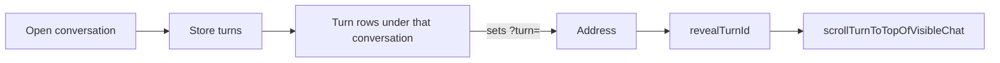

# Sidebar turn outline

The open conversation already lands in the store (`Chat` calls `setConversationFromRead`, and a send calls `addConversationTurn`). The sidebar reads that record. Summaries stay `{ conversationId }` only. No list-API or HTTP change.

`?turnIds=` remains the turns added to the next prompt ([FR-MCP-CTX-007](docs/specs/requirements/fr/mcp/context.md)). `?turn=` names the turn to show. Scroll stays on `[data-turn-id]` via [geometry](frontend/src/components/pages/conversation/geometry/index.ts), not a hash or an element `id`.

## 1. Requirements, acceptance, ticket

Add two requirements to [conversation.md](docs/specs/requirements/fr/mcp/conversation.md):

- **FR-MCP-CNV-010** — The user can bring a turn of the open conversation into view.
- **FR-MCP-CNV-011** — That turn is part of the conversation address, and opening the address brings the same turn into view.

Add client scenarios to [conversation.md](docs/specs/architecture/client/mcp/conversation.md). [CLIENT-MCP-CNV-005](docs/specs/architecture/client/mcp/conversation.md) stays “newest turn in view” when the address names no turn.

- **CLIENT-MCP-CNV-011** — The open conversation lists its turns under that conversation, prompt as the label, oldest first. Other conversations have no turn rows.
- **CLIENT-MCP-CNV-012** — Activating a listed turn brings it into view and writes `turn` on the address. Existing `turnIds` stay as they are.
- **CLIENT-MCP-CNV-013** — Opening an address whose `turn` is a turn of that conversation brings that turn into view. An unknown `turn` leaves the newest turn in view.

No HTTP scenario. Ticket [docs/tickets/mcp/tkt-mcp-005-turn-outline.md](docs/tickets/mcp/tkt-mcp-005-turn-outline.md), branch `feat/tkt-mcp-005-turn-outline`, label `feature`. DoD links the three client scenarios.

## 2. Address helpers

In [helpers/index.ts](frontend/src/components/pages/conversation/helpers/index.ts), add `readTurn` and `writeTurn` for a single `turn` param, next to `readTurnIds` / `writeTurnIds`. Writing `turn` must not change `turnIds`. An empty value removes `turn`.

## 3. Sidebar rows

[SidebarRouteItem](frontend/src/components/blocks/sidebar/Sidebar.types.ts) gains an optional `routes` of the same shape, one level down. [SubMenuItem](frontend/src/components/blocks/sidebar/menuItem/subMenuItem/SubMenuItem.tsx) renders that level. Turn rows set `includeActions: false`.

Active state today is `pathname === route.to`. A `to` that includes `?turn=` will never match. Compare the path, and treat a turn row as current only when its `turn` param matches.

In [Dashboard.tsx](frontend/src/components/layout/dashboard/Dashboard.tsx), keep building conversation rows from `summaries`. For the row whose id is the route `conversationId`, if `getConversation` returns it, nest one row per `turns` entry:

- `id` is `turnId`
- `label` is `prompt`
- `to` is `buildConversationUrl(conversationId)` plus `?turn=<turnId>`, with the current `turnIds` copied onto that link

No turn rows on `/conversations/create`, and none on a conversation that is not in the store yet.

## 4. Scroll from the address

In [Conversation.tsx](frontend/src/components/pages/conversation/Conversation.tsx):

- Read `turn` from the search params.
- After that conversation’s turns are committed, if `turn` matches one of them, set `revealTurnId`. The existing effect opens a collapsed turn and calls `scrollTurnToTopOfVisibleChat`.
- Skip `placeOpenedConversationAtBottom` when that match exists.
- Run this once per `conversationId` + `turn` pair, so a later turn update does not pull the view back.
- When a prompt is pinned for send, remove `turn` from the address so the new prompt keeps the view.
- An unknown `turn` does nothing; the newest turn stays in view.

Remove the two conversation-sidebar TODO lines in [App.tsx](frontend/src/App.tsx). Leave the other TODOs.

## 5. Tests

Extend [Conversation.test.tsx](frontend/src/components/pages/conversation/Conversation.test.tsx), which already renders `Dashboard`:

- Open a stored conversation and assert its prompts appear under that sidebar row, and another summary has no turn rows.
- Activate a turn row and assert the address contains `turn` and not a changed `turnIds`, and that `scrollTurnToTopOfVisibleChat` runs for that id.
- Load `/conversations/:id?turn=<older>` and assert the older turn is scrolled into view, not the bottom placement.
- Load an unknown `turn` and assert the existing newest-turn scroll still runs.
